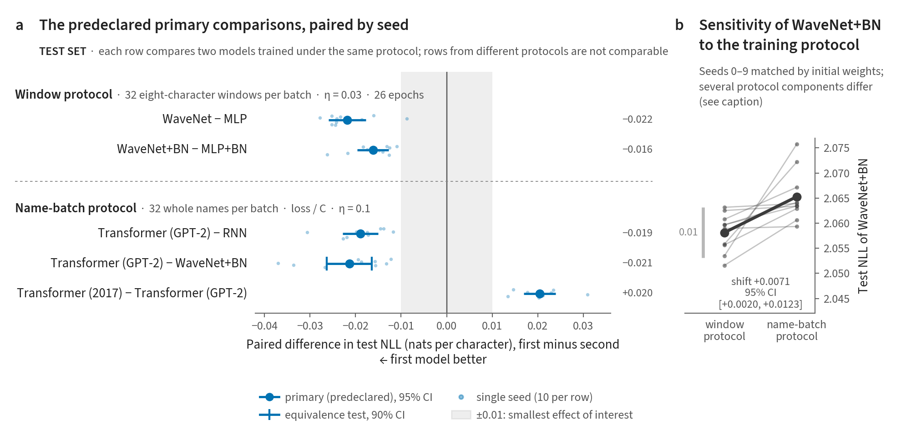
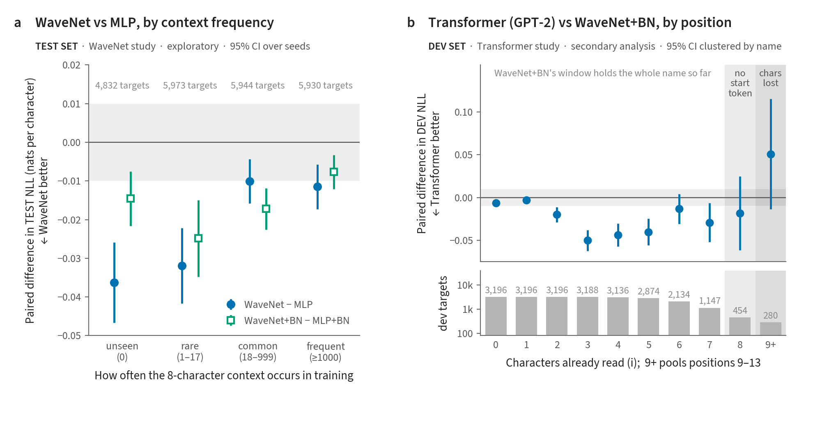

# Language Models From Scratch

Character-level language models, from a counting bigram to two Transformer designs, each implemented in PyTorch from its specification and studied in a controlled experiment. Every step asks what the architectural change actually buys, and answers with predeclared comparisons, ten paired seeds, a declared smallest effect of interest and a test split used once.

The models of the first stages follow Andrej Karpathy's makemore lectures. The recurrent and attention models, the five studies and the methodology go beyond them ([what comes from where](#foundation-and-what-this-repository-adds)). The headline result: at about 23k parameters and under one training protocol, a GPT-2-style Transformer beats a vanilla RNN and a WaveNet-style tree by about 0.02 nats per character on every seed, but not by reaching further back. Its lead lies in the first eight characters of a name, which the tree also sees in full.

[Findings](#key-findings) · [Results](#results) · [Method](#how-the-evidence-was-produced) · [Engineering](#engineering) · [Studies](#the-studies) · [Limitations](#limitations) · [Reproduce](#reproduce) · [References](#references-and-acknowledgements)



**Figure 1.** (a) The predeclared primary comparisons, as paired differences in test NLL: each row is the mean over ten seeds with its 95% confidence interval, and the faint dots are the single seeds. The shaded band is ±0.01 nats, the smallest effect of interest fixed before any test evaluation. The comparison with WaveNet+BN was declared as an equivalence test and is shown with its 90% interval. Each row compares two models trained under the same protocol; rows from different protocols are not comparable. (b) Sensitivity of WaveNet+BN to the training protocol: the same model, with matched initial weights for each seed, trained under both protocols. They differ in batch construction (eight-character windows against whole names), loss normalisation (mean against sum / C), learning rate (0.03 against 0.1), epoch budget (26 against 30), steps per epoch (5,709 against 802) and data order, so the +0.0071 shift is the effect of the combined protocol change, not of any single component. Model names are defined [below](#results). Built by [`figures/`](figures/) from the published result files.

## Foundation and what this repository adds

The project began with four of Andrej Karpathy's makemore lectures ([Neural Networks: Zero to Hero](https://karpathy.ai/zero-to-hero.html), parts 1, 2, 3 and 5). They supplied the concepts and architectures of the first stages. All code here was written independently, from the lectures and the original papers; the course's code repository was not used. The dataset, [`data/names.txt`](data/), is the one distributed with the course.

| Component | From the lectures | What this repository adds |
|---|---|---|
| Bigram, counting and neural ([statistical](models/statistical/), [neural](models/feedforward/#neural-bigram)) | Both models, NLL evaluation, sampling | Specifications and tests; analysis of why gradient descent converges to the counting solution, with the 1/t decay of probability on unseen transitions measured ([bigram study](training/bigram_study/)) |
| [MLP](models/feedforward/#mlp) | The architecture (Bengio et al. 2003), learning-rate search, train/dev/test splits | Pilot-selected learning rate, schedule and epoch budget on separate seeds; a paired comparison of context 3 against context 8 ([MLP study](training/mlp_study/)) |
| [BatchNorm](models/feedforward/#batchnorm-mlp) and training diagnostics | Batch normalisation, activation and gradient statistics | Evaluation statistics recomputed exactly over the training set instead of a running average; shared diagnostics in [`utils/diagnostics/`](utils/diagnostics/) |
| [WaveNet-style tree](models/hierarchical/) | The hierarchical architecture | A predeclared 2×2 experiment, tree against flat and with or without BatchNorm, at equal size and context ([WaveNet study](training/wavenet_study/)) |
| [Vanilla RNN](models/recurrent/) | Not covered | Hand-written recurrence with full backpropagation through time; a study of gradient propagation and context use ([RNN study](training/rnn_study/)) |
| [Transformers](models/attention/), 2017 and GPT-2 designs | Not covered | Both designs from their papers, verified against an independent float64 implementation; a controlled comparison with the RNN and the tree ([Transformer study](training/transformer_study/)) |
| Methodology and infrastructure | Not covered | Specifications before code, predeclared studies, a published [decision log](DECISIONS.md), one-time test evaluation, more than 2,000 tests |

## Key findings

1. **The GPT-2-style Transformer wins; the 2017 design does not.** Under one protocol, Transformer (GPT-2) reaches a test NLL of 2.0439 ± 0.0014. That is 0.019 below the RNN (95% CI 0.015 to 0.023) and 0.021 below WaveNet+BN, on all ten seeds. Equivalence with WaveNet+BN was our main expectation, and it was rejected: the interval lies beyond the margin, in the Transformer's favour. The 2017 design, at the same shape and learning rate, is 0.020 worse than the GPT-2 design and statistically tied with the RNN and WaveNet+BN. [Report §5](results/experiments/transformer_study/REPORT.md#5-test-results)

2. **The Transformer's advantage is short-range.** On dev data, its whole lead over WaveNet+BN comes from the first eight characters of a name (−0.026 ± 0.002 nats per target), where WaveNet+BN's 8-character window already sees everything. Late in long names, where the window loses characters, the Transformer is not ahead (+0.051 ± 0.033, inconclusive). This refutes our hypothesis that any advantage would appear where the window ends. [Report §6](results/experiments/transformer_study/REPORT.md#6-where-the-advantage-comes-from-t-rq1b)

3. **A hierarchical tree beats a flat MLP at equal size and context.** With the same 8 characters and about 22k parameters, the tree's test NLL is lower by 0.022 without BatchNorm and 0.016 with it, on 10 of 10 seeds, both beyond the 0.01 margin. In an exploratory breakdown, the advantage concentrates on contexts that are rare or absent in training (−0.036 on unseen contexts against −0.011 on frequent ones). The comparison changes depth, width and weight sharing together, so it measures that bundle, not "hierarchy" alone. [WaveNet report](results/experiments/wavenet_study/final/analysis/final/REPORT.md#primary-endpoint-test-nll-nats-per-character)

4. **The RNN learns an expansive recurrence but uses little distant context.** At initialisation, gradients shrink by 0.355 log-units per step, as mean-field signal-propagation theory predicts. Training raises the largest singular value of the recurrent matrix from 1.00 to 3.58 and tanh saturation from about 2% to 19%, and typical gradients then shrink by only 0.13 per step. Yet keeping only the last 8 characters of a long name raises the NLL of its late characters by just 0.016 ± 0.023 nats. [RNN report §7](results/experiments/rnn_study/REPORT.md#7-quantitative-results)

5. **Two methodological results.** First, the training protocol alone moves the same model, WaveNet+BN, by +0.0071 in test NLL (95% CI 0.0020 to 0.0123), close to the size of the architectural effects (Figure 1b). This is why results are compared only within a protocol. Second, the diagnostic that measures context use in the RNN, restarting the name from its start token, is confounded for Transformers, because it also resets absolute positions. Keeping the positions removes most of the measured penalty: with only the last 3 characters, the Transformers lose 0.09–0.23 nats with positions kept against 2.3–2.5 with positions reset. [Report §7](results/experiments/transformer_study/REPORT.md#7-context-use-and-attention-t-rq3-t-rq4)



**Figure 2.** Where the architectural advantages come from. (a) WaveNet study: the paired difference in test NLL between WaveNet and the MLP, without and with batch normalisation, grouped by how often the target's 8-character context occurs in training. Exploratory: the categories were fixed on dev before the single test evaluation; intervals are 95% confidence intervals over ten seeds. (b) Transformer study: the paired difference in dev NLL between Transformer (GPT-2) and WaveNet+BN by the number of characters already read, positions 9–13 pooled. The shading marks what WaveNet+BN's window contains: the whole name so far up to i = 7, no start token at i = 8, fewer characters than the name from i = 9. The intervals are 95% intervals from standard errors clustered by name, which treat each name rather than each character as the unit of variation; seed variability enters through the average over ten seeds. The Transformer is ahead at positions 0, 2–5 and 7, by more than 0.01 at positions 2–5; from position 8 on, no difference is established. The panels come from different studies, endpoints and protocols, so their magnitudes are not directly comparable.

## Results

Test NLL in nats per character, mean ± standard error over ten seeds, each evaluated once after every setting was fixed. The uniform distribution over 27 characters scores ln 27 = 3.296. **Rows are comparable only within their protocol group.**

| Model | Parameters | Context | Test NLL | Study |
|---|---:|---|---:|---|
| ***Counting and gradient descent, dev only*** | | | | |
| Statistical bigram (α = 0.3) | 729 counts | 1 character | dev 2.4570 | [bigram](training/bigram_study/) |
| Neural bigram (best step) | 729 | 1 character | dev 2.4569 | [bigram](training/bigram_study/) |
| ***MLP study protocol*** (pilot-selected settings) | | | | |
| MLP | 11,897 | 3 characters | 2.1291 ± 0.0007 | [MLP](training/mlp_study/) |
| MLP+BN | 12,097 | 3 characters | 2.1455 ± 0.0009 | [MLP](training/mlp_study/) |
| ***Window protocol*** (8-character windows, η = 0.03, 26 epochs) | | | | |
| MLP | 21,897 | 8 characters | 2.0903 ± 0.0014 | [WaveNet](training/wavenet_study/) |
| MLP+BN | 22,097 | 8 characters | 2.0743 ± 0.0011 | [WaveNet](training/wavenet_study/) |
| WaveNet | 21,989 | 8 characters | 2.0685 ± 0.0012 | [WaveNet](training/wavenet_study/) |
| WaveNet+BN | 22,397 | 8 characters | 2.0581 ± 0.0012 | [WaveNet](training/wavenet_study/) |
| ***Name-batch protocol*** (32 whole names per batch, η = 0.1) | | | | |
| RNN | 23,451 | whole name | 2.0628 ± 0.0010 | [RNN](training/rnn_study/) |
| WaveNet+BN | 22,397 | 8 characters | 2.0653 ± 0.0016 | [Transformer](training/transformer_study/) |
| Transformer (2017) | 22,680 | whole name | 2.0644 ± 0.0006 | [Transformer](training/transformer_study/) |
| Transformer (GPT-2) | 23,604 | whole name | **2.0439 ± 0.0014** | [Transformer](training/transformer_study/) |

**Model names.** MLP and MLP+BN: a flat one-hidden-layer MLP, without and with batch normalisation. WaveNet and WaveNet+BN: the hierarchical tree of this project (not the audio WaveNet), without and with batch normalisation. RNN: a single-layer Elman RNN with hidden size 128. Transformer (2017) and Transformer (GPT-2): one-layer decoder-only Transformers of width 42 following the 2017 and the GPT-2 designs; neither is the original model. WaveNet+BN appears twice because it was trained separately under each protocol.

Within the MLP study, going from 3 to 8 characters of context lowers dev NLL by 0.058 (MLP) and 0.070 (MLP+BN) on every paired seed: context is a larger lever than any architectural change measured here. [MLP results](models/feedforward/#context-length-and-batchnorm-a-paired-comparison)

## How the evidence was produced

- **Specified before implemented.** Each model has a specification (architecture, mathematics, initialisation, diagnostics, tests) written from [a common template](MODEL_SPECIFICATION_TEMPLATE.md) and approved before any code.
- **Predeclared.** Questions, hypotheses, primary comparisons, the smallest effect of interest (0.01 nats) and decision rules are fixed before the runs. Decisions up to the RNN study are logged with their rationale in [`DECISIONS.md`](DECISIONS.md); the Transformer study records its decisions in [its report](results/experiments/transformer_study/REPORT.md#3-configuration).
- **Selection never touches test data.** Learning rates, shapes and epoch budgets are chosen by pilots on separate seeds and dev data.
- **Paired designs.** Every arm of a study sees the same batches for the same seed, so comparisons are differences within seed pairs.
- **Uncertainty that matches the question.** 95% intervals over seeds for test results; Holm correction within each predeclared family; equivalence by two one-sided tests; standard errors clustered by name for per-character analyses.
- **The test split is evaluated once,** by a script that refuses to run twice; in the WaveNet, RNN and Transformer studies only after the checkpoints and code are frozen by hash.
- **Negative results are reported as declared.** A failed equivalence test, a refuted position hypothesis and a confounded diagnostic stay in the reports as they were found, with any reinterpretation stated separately.

## Engineering

- **Hand-written recurrence and attention.** The RNN and both Transformers are written out on PyTorch tensors and autograd: the recurrence, causal multi-head attention, LayerNorm, GELU and positional encodings. `nn.RNN`, `nn.Transformer`, `nn.MultiheadAttention`, `nn.LayerNorm` and `nn.Linear` are not used in them. The MLPs and the tree are built from standard `nn.Embedding`, `nn.Linear` and BatchNorm layers.
- **Independent verification.** Separately written reference implementations check the tree, the RNN and both Transformers; the Transformers agree with their float64 reference to 1e-12. The RNN study also passed 38 of 38 planted defects (mutation testing).
- **Reproducible runs.** Seeded, deterministic training with separate random streams for initialisation and data order; repeated runs of the same seed were checked to be bit-identical by parameter hash. The WaveNet and RNN study drivers refuse to run if any pinned file has changed.
- **One shared infrastructure** for data and splits, batching, metrics, checkpoints, run records and diagnostics ([`utils/`](utils/)), and **more than 2,000 tests** in [`tests/`](tests/).
- **Laptop scale.** Everything runs on a laptop CPU.

## The studies

| Study | Question | Design | Outcome |
|---|---|---|---|
| [Bigram](training/bigram_study/) | Do a counting model and a gradient-trained model learn the same distribution? | Both on the standard split, dev only | They converge to the same distribution; unseen transitions lose probability like 1/t, and early stopping acts like smoothing |
| [MLP](training/mlp_study/) | What settings does the MLP need, and how much does context matter? | Pilots on separate seeds; ten final seeds; paired context 3 against 8 | Test 2.129 and 2.146; five more characters of context lower dev NLL by 0.06–0.07 |
| [WaveNet](training/wavenet_study/) | Does hierarchical merging beat a flat layer at equal size, with and without BatchNorm? | 2×2 design, ten paired seeds, Holm-corrected primary family, test once after a freeze | Tree better in both cases; BatchNorm's effect inside the tree inconclusive ([report](results/experiments/wavenet_study/final/analysis/final/REPORT.md)) |
| [RNN](training/rnn_study/) | How do gradients and context dependence behave across the recurrence, at initialisation and in training? | Jacobian, gradient and context diagnostics at 49 points per run; ten seeds; hash-frozen | Finding 4 ([report](results/experiments/rnn_study/REPORT.md)) |
| [Transformer](training/transformer_study/) | Does attention add value over recurrence and hierarchy at equal size? | Four arms under one protocol, shape and budgets by pilot, equivalence test, name-clustered position analysis | Findings 1, 2 and 5 ([report](results/experiments/transformer_study/REPORT.md)) |

## Limitations

- **Small scale.** One dataset of 32,033 names of at most 15 characters, models of about 23k parameters, ten seeds. Nothing here concerns long contexts or large models.
- **Comparisons of bundles.** Tree against flat, and the 2017 against the GPT-2 design, change several choices at once; the results belong to those bundles.
- **Protocol-bound results.** Every comparison holds within its training protocol, and the protocol itself moves results by about 0.007 (Figure 1b).
- **One optimiser.** All final models are trained with plain SGD; conclusions under other optimisers were not tested.

Each study's report lists its own limitations in full.

## Reproduce

```bash
pip install -r requirements-dev.txt     # Python ≥ 3.10, PyTorch ≥ 2.0
python3 -m pytest -q                    # the full test suite
python3 figures/make_figures.py         # rebuild both figures from the published results
```

Each study README describes its stages, what is published and how to check the results.

```
models/      one folder per model family: code, specification and README
training/    one folder per study: drivers, protocols and README
results/     published study results (results/experiments/<study>/)
figures/     the README figures, their shared style and bundled font
tests/       tests for every model, utility, study driver and figure
utils/       shared infrastructure: data, splits, metrics, checkpoints, diagnostics
configs/     base and per-model configuration
data/        the dataset and its provenance
```

## References and acknowledgements

**Course.** A. Karpathy, *Neural Networks: Zero to Hero*, makemore lectures parts 1–3 and 5 ([course page](https://karpathy.ai/zero-to-hero.html)): the concepts and architectures of the bigram, MLP, BatchNorm and WaveNet stages, and the dataset.

**Models and architectures**
- Bengio, Ducharme, Vincent & Jauvin (2003), [A Neural Probabilistic Language Model](https://www.jmlr.org/papers/v3/bengio03a.html): the MLP, embeddings of the previous characters concatenated into a hidden layer.
- Ioffe & Szegedy (2015), [Batch Normalization](https://arxiv.org/abs/1502.03167): the normalisation in MLP+BN and WaveNet+BN.
- van den Oord et al. (2016), [WaveNet](https://arxiv.org/abs/1609.03499): the idea of merging the context hierarchically, in pairs.
- Elman (1990), [Finding Structure in Time](https://doi.org/10.1207/s15516709cog1402_1): the recurrent architecture of the RNN.
- Vaswani et al. (2017), [Attention Is All You Need](https://arxiv.org/abs/1706.03762): Transformer (2017), with sinusoidal positions, √d embedding scaling, post-LayerNorm, ReLU and tied embeddings.
- Radford et al. (2018), [Improving Language Understanding by Generative Pre-Training](https://cdn.openai.com/research-covers/language-unsupervised/language_understanding_paper.pdf), and Radford et al. (2019), [Language Models are Unsupervised Multitask Learners](https://cdn.openai.com/better-language-models/language_models_are_unsupervised_multitask_learners.pdf): Transformer (GPT-2), with learned positions, pre-LayerNorm with a final LayerNorm and the scaled residual initialisation.
- Ba, Kiros & Hinton (2016), [Layer Normalization](https://arxiv.org/abs/1607.06450): the normalisation in both Transformers.
- Hendrycks & Gimpel (2016), [Gaussian Error Linear Units](https://arxiv.org/abs/1606.08415): the GELU, in its tanh approximation, in Transformer (GPT-2).
- Press & Wolf (2017), [Using the Output Embedding to Improve Language Models](https://arxiv.org/abs/1608.05859): the output layer tied to the token embedding.
- Xiong et al. (2020), [On Layer Normalization in the Transformer Architecture](https://arxiv.org/abs/2002.04745): why post-LayerNorm tolerates large learning rates worse, used to read the 2017 design's divergence at η = 1.0.

**Initialisation and training dynamics**
- LeCun, Bottou, Orr & Müller (1998), *Efficient BackProp*: LeCun-normal initialisation in the WaveNet tree.
- Glorot & Bengio (2010), [Understanding the Difficulty of Training Deep Feedforward Neural Networks](https://proceedings.mlr.press/v9/glorot10a.html): Glorot-uniform initialisation in Transformer (2017).
- Saxe, McClelland & Ganguli (2014), [Exact Solutions to the Nonlinear Dynamics of Learning in Deep Linear Neural Networks](https://arxiv.org/abs/1312.6120): orthogonal initialisation of the recurrent matrix.
- Mezzadri (2007), [How to Generate Random Matrices from the Classical Compact Groups](https://arxiv.org/abs/math-ph/0609050): sampling the Haar-random orthogonal matrix.
- Werbos (1990), [Backpropagation Through Time](https://doi.org/10.1109/5.58337): full backpropagation through time, without truncation.
- Bengio, Simard & Frasconi (1994), [Learning Long-Term Dependencies with Gradient Descent is Difficult](https://doi.org/10.1109/72.279181), and Pascanu, Mikolov & Bengio (2013), [On the Difficulty of Training Recurrent Neural Networks](https://arxiv.org/abs/1211.5063): the vanishing-gradient problem and Jacobian products, which motivate the RNN study's diagnostics.
- Poole et al. (2016), [Exponential Expressivity in Deep Neural Networks through Transient Chaos](https://arxiv.org/abs/1606.05340), and Schoenholz et al. (2017), [Deep Information Propagation](https://arxiv.org/abs/1611.01232): the mean-field recursions for pre-activation variance and the per-step gradient factor, used for the RNN's predicted attenuation at initialisation.
- Chen, Pennington & Schoenholz (2018), [Dynamical Isometry and a Mean Field Theory of RNNs: Gating Enables Signal Propagation in Recurrent Neural Networks](https://arxiv.org/abs/1806.05394): mean-field theory applied to recurrent networks.

**Statistics**
- Holm (1979), [A Simple Sequentially Rejective Multiple Test Procedure](https://www.jstor.org/stable/4615733): the multiplicity correction within each predeclared family.
- Schuirmann (1987), [A Comparison of the Two One-Sided Tests Procedure and the Power Approach for Assessing the Equivalence of Average Bioavailability](https://doi.org/10.1007/BF01068419), and Lakens (2017), [Equivalence Tests: A Practical Primer for t Tests, Correlations, and Meta-Analyses](https://doi.org/10.1177/1948550617697177): the equivalence test and the smallest effect of interest.
- Cameron & Miller (2015), [A Practitioner's Guide to Cluster-Robust Inference](https://doi.org/10.3368/jhr.50.2.317): standard errors clustered by name.
- Fisher (1935), *The Design of Experiments*: the exact sign-flip (randomisation) test used as a check in the WaveNet study.

## Licence

[MIT](LICENSE) © 2026 Nur Taabaldiev
